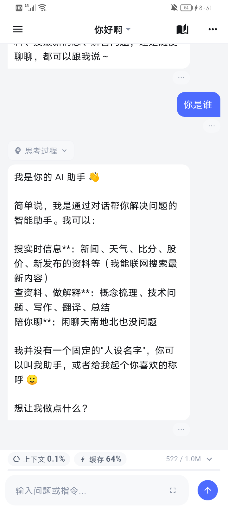
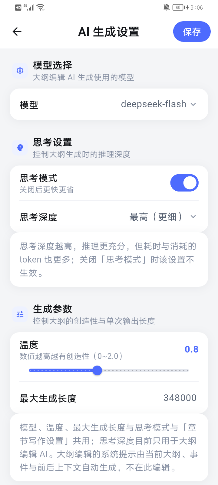
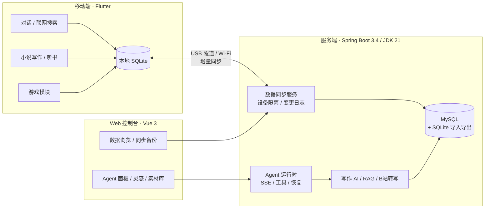

<div align="center">

# AI 小说创作平台

**移动端写作 App + Web 数据控制台 + Spring Boot Agent 服务**

面向个人创作者的 AI 小说创作平台：在一个 App 里完成对话、找素材、生成大纲、写章节、推演剧情，
在浏览器里浏览与编辑全部数据，并由一个可断线恢复的 Agent 服务把工具调用、RAG、联网搜索串起来。


</div>

---

## 项目简介

这是一个 **AI 小说创作平台**，由三端组成：

- **移动端（Flutter）**：日常写作入口。对接 DeepSeek 流式对话与联网搜索，支持大纲生成、章节写作/改写、
  灵感推演、AI 对战、角色对话、文字 TRPG、听书（本地 TTS）。
- **Web 控制台（Vue 3）**：数据台。24 张表全部可浏览/搜索/编辑，支持会话查看、同步与备份、
  情节素材库（RAG）、B站视频转文字、Agent 面板与下载库。
- **服务端（Spring Boot + Spring AI）**：多设备数据同步（设备间物理隔离）+ Agent 运行时
  （SSE 事件、断线重连、进程重启恢复、工具调用）+ 写作 AI + RAG 检索。

数据默认只存在本地：手机端用 SQLite，Web 端用 MySQL；所有数据库、日志、密钥都被 `.gitignore` 排除，
不会出现在仓库里。

---

## 界面预览

<table>
  <tr>
    <td align="center" width="33%">
      <br/>
      <sub>移动端 · 新对话</sub>
    </td>
    <td align="center" width="33%">
      <br/>
      <sub>移动端 · 流式对话 / 思考过程 / 上下文与缓存</sub>
    </td>
    <td align="center" width="33%">
      <br/>
      <sub>移动端 · 写作 AI 设置</sub>
    </td>
  </tr>
</table>

<table>
  <tr>
    <td align="center" width="50%">
      <br/>
      <sub>Web 控制台 · 情节素材库（RAG 检索与仿写）</sub>
    </td>
    <td align="center" width="50%">
      <br/>
      <sub>Web 控制台 · Agent 下载库</sub>
    </td>
  </tr>
</table>

---

## 核心亮点

- **事件驱动的 Agent 运行时**：`session → message → run → event` 全量持久化，SSE 事件带自增 `seq`，
  前端断线后按 `seq` 回放，不重不漏；支持进程重启恢复、用户取消、会话单飞。
- **长上下文工程**：面向 1M 窗口的检查点式压缩（阈值 `min(W×0.8, W−64K)`，保留最近 16% 原文，
  检查点落库），长会话不再按轮数硬截断。
- **前缀缓存优化**：系统提示稳定化、工具定义排序、变化内容后置；同一会话第二轮缓存命中
  **2816 / 3010 ≈ 93.6%**，并在界面上展示会话累计与单条消息的命中率。
- **工具平台**：基于 Spring AI `@Tool` 注册 14 个工具，覆盖数据查询、RAG、大纲/章节生成、任务计划、
  向用户提问、联网搜索、文件下载；写操作自动落库。
- **多设备数据隔离**：每台设备在服务端有独立的库与变更日志，A 设备的数据物理上不会进入 B 设备，
  同一 ID 的行也不会互相覆盖。
- **USB 隧道同步**：服务端自动用 `adb reverse` 把手机的 `127.0.0.1:3210` 接到电脑；
  手机端按「USB 隧道 → 历史地址 → 热点网关 → UDP 广播 → 网段扫描」逐级兜底。
- **安全边界**：敏感列剔除与打码、下载工具 SSRF 防护（仅 http/https、拒绝内网）、
  文件大小与分页限制、事件文本截断。

---

## 功能模块

| 模块 | 能力 |
| --- | --- |
| 对话 | DeepSeek 流式问答、Markdown 渲染、思考过程折叠、联网搜索来源、上下文占用与缓存命中展示、会话历史 |
| 小说写作 | 大纲生成（分阶段）、大纲编辑与格式校验、章节写作/改写、灵感推演（并行候选 + 合并）、AI 对战、听书 TTS |
| 游戏 | 角色对话、文字 TRPG、小说互动游戏 |
| 数据同步 | 多设备隔离、增量同步、冲突留档、`.db` 导入导出、USB / 局域网自动发现 |
| Web 控制台 | 总览、会话、24 张表通用数据浏览器、同步与备份、情节素材库、B站视频转文字、下载库、Agent 面板 |
| Agent | 14 个工具、任务计划、向用户提问、SSE 实时渲染、断线重连与恢复、会话级设置与用量统计 |
| 应用更新 | 更新公告、APK 下载与版本隔离 |

---

## 系统架构



---

## 技术栈

| 端 | 技术 |
| --- | --- |
| 移动端 | Flutter（Dart 3.12）、Riverpod、Dio、sqflite、flutter_markdown_plus、sherpa-onnx（本地 TTS） |
| 服务端 | Java 21、Spring Boot 3.4.5、Spring AI 1.0.9、MyBatis-Plus 3.5.9、MySQL 8、sqlite-jdbc、SSE、虚拟线程 |
| Web 控制台 | Vue 3.5、TypeScript 5.9、Pinia、Vue Router、Element Plus、Vite 7 |
| 数据与检索 | MySQL / SQLite、Elasticsearch、阿里百炼 Embedding、DeepSeek API |

---

## 快速开始

### 环境要求

- Flutter（Dart SDK ≥ 3.12.2）
- JDK 21、MySQL 8（服务端主存储）
- Node.js 18+ 与 npm
- 可选：`adb`（USB 隧道同步）、Python + faster-whisper（B站视频本地转写）

### 1. 移动端

```bash
flutter pub get
flutter run
```

打包调试包真机验证：

```powershell
flutter build apk --debug
adb install -r build\app\outputs\flutter-apk\app-debug.apk
```

首次使用请在 App「设置」里填入 DeepSeek API Key。同步功能是可选的，不连服务端也能单独使用。

### 2. 服务端

```powershell
cd web/server-java
.\mvnw.cmd spring-boot:run
```

macOS / Linux：

```bash
cd web/server-java
./mvnw spring-boot:run
```

默认监听 `http://localhost:3210`。常用环境变量（建议写在 `web/server/.env`，该文件已被忽略）：

| 变量 | 说明 |
| --- | --- |
| `DEEPSEEK_API_KEY` | DeepSeek 密钥，Agent / 写作 / RAG 均使用 |
| `DASHSCOPE_API_KEY` | 阿里百炼 Embedding 密钥（RAG 可选） |
| `MYSQL_HOST` / `MYSQL_PORT` / `MYSQL_DATABASE` / `MYSQL_USER` / `MYSQL_PASSWORD` | 数据库连接 |
| `API_TOKEN` | 接口令牌；**公网部署必须设置**，否则任何人都能读写数据 |
| `DATA_DIR` | 数据目录，默认 `web/server/data` |
| `PORT` | 服务端口，默认 `3210` |

### 3. Web 控制台

```bash
cd web/app
npm install
npm run dev      # http://localhost:5173，/api 自动代理到 3210
npm run build    # 产物由服务端同源托管
```

生产模式下先 `npm run build`，再启动服务端，直接访问 `http://localhost:3210` 即可。

---

## 目录结构

```
.
├─ lib/                       Flutter App 源码
│  ├─ core/                   网络 / 数据库 / 配置 / 通用组件
│  └─ features/
│     ├─ chat/                对话与联网搜索
│     ├─ novel_writing/       大纲 / 章节 / 灵感 / 对战 / 听书
│     ├─ game/                角色对话 / TRPG / 小说游戏
│     ├─ sync/                多设备数据同步
│     └─ update/              应用更新
├─ android/                   Android 工程（TTS 模型与 so 位于 app/src/main/assets、libs）
├─ web/
│  ├─ app/                    Vue 3 控制台
│  ├─ server-java/            Spring Boot 服务（同步 / Agent / 写作 / RAG / B站转写）
│  ├─ docs/                   使用指南 / 同步协议 / 数据模型 / RAG 说明
│  └─ server/data/            运行时数据目录（数据库、密钥，已被 git 忽略）
├─ test/                      单元测试与 UI 测试
└─ docs/screenshots/          README 截图
```

---

## 文档

- [Web 数据台说明](web/README.md)
- [使用指南](web/docs/使用指南.md)
- [同步协议](web/docs/同步协议.md)
- [数据模型](web/docs/数据模型.md)
- [RAG 素材库](web/docs/rag.md)
- [开发文档](开发文档.md)

---

## 安全与隐私

- 仓库**不包含**任何数据库、运行日志、会话截图或个人数据；`*.db`、`web/server/`、`reports/`
  等运行时目录均已加入 `.gitignore`。
- API Key 只通过环境变量或 `web/server/.env` 注入，配置文件里全部是占位符。
- `application.yml` 中的数据库密码、DeepSeek Key、百炼 Key 均从环境变量读取，不在仓库中保存明文。
- 公网部署务必设置 `API_TOKEN`；默认配置面向本机 / 局域网使用。
- 导出数据库时会清空 `apiKey` / `baidu_api_key` 等敏感字段，方便备份与分享。
- Agent 的下载工具只允许 http/https，拒绝本机与内网地址，并限制文件大小，防止 SSRF。

---

## 已知限制

- 单机部署，进程内并发上限 8；run / ask 注册表在内存中，重启恢复是单机语义。
- 暂无多租户与 RBAC，身份依赖客户端自报的 `x-device-id` + 可选全局令牌。
- 写类工具（生成大纲 / 章节）暂未接入人工审批。
- 暂无 CI/CD 与 Agent 评测集。

---

<div align="center">
<sub>如果这个项目对你有帮助，欢迎 Star ⭐</sub>
</div>
