<div align="center">

# AI 小说创作平台

**移动端写作 App + Web 数据控制台 + Spring Boot Agent 服务**

面向个人创作者的 AI 小说创作平台：在一个 App 里完成对话、找素材、生成大纲、写章节、推演剧情，
在浏览器里浏览与编辑全部数据，并由一个可断线恢复的 Agent 服务把工具调用、RAG、联网搜索串起来。


</div>

---

## 项目简介

这是一个 **AI 小说创作平台**，由三端组成：

- **移动端（Flutter）**：日常写作入口。对接 DeepSeek 流式对话与联网搜索，支持大纲生成、章节写作/改写、
  灵感推演、AI 对战、角色对话、文字 TRPG、听书（本地 TTS）。
- **Web 控制台（Vue 3）**：数据台。31 张表（deepseek 24 + novel 7）全部可浏览/搜索/编辑，支持会话查看、同步与备份、
  情节素材库（RAG）、B站视频转文字、Agent 面板与下载库。
- **服务端（Spring Boot + Spring AI）**：多设备数据同步（设备间物理隔离）+ Agent 运行时
  （SSE 事件、断线重连、进程重启恢复、工具调用）+ 写作 AI + RAG 检索。

数据默认只存在本地：手机端用 SQLite，Web 端用 MySQL；所有数据库、日志、密钥都被 `.gitignore` 排除，
不会出现在仓库里。

---

## 界面预览

### Agent：提问 → 工具调用 → 任务清单 → 回答

Agent 面板支持流式回答、思考过程、工具调用卡片（可展开查看完整入参与返回）、向用户提问、
多步任务清单，以及上下文占用与缓存命中展示。下图为一次真实会话：Agent 先反问题材方向，
再用 `plan_task` 拆出三步计划、用 `search_rag` 检索参考桥段，最后汇总建议。

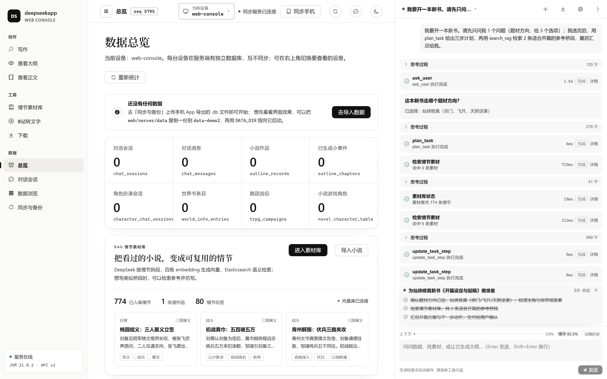
<table>
  <tr>
    <td align="center" valign="top" width="50%">
      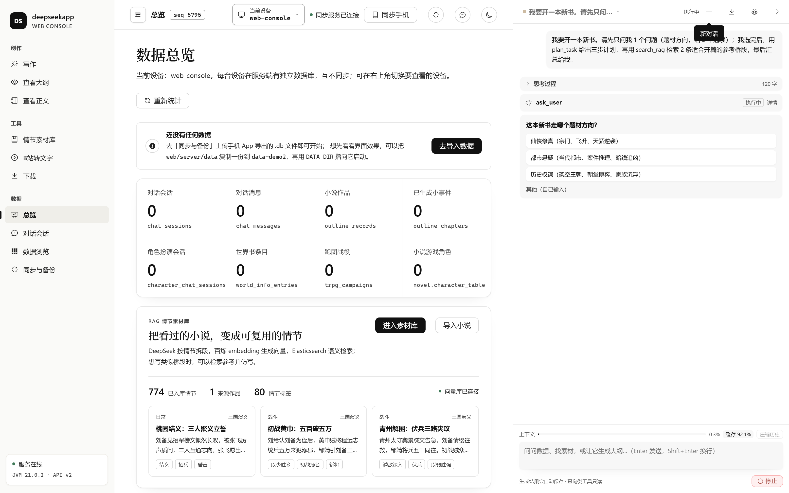<br/>
      <sub>提问卡 · 给出候选题材方向，也可以自己输入</sub>
    </td>
    <td align="center" valign="top" width="50%">
      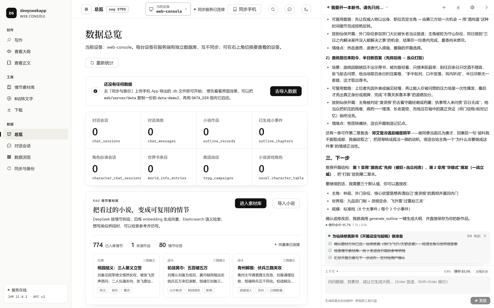<br/>
      <sub>任务清单 · 步骤状态实时更新，3/3 完成</sub>
    </td>
  </tr>
  <tr>
    <td align="center" valign="top" width="50%">
      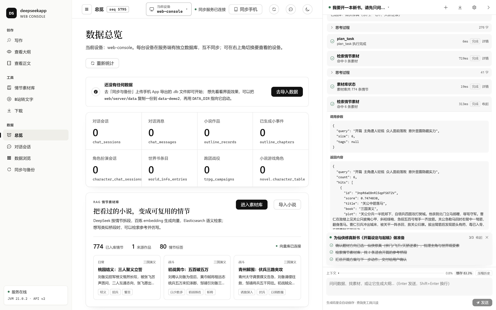<br/>
      <sub>工具调用 · 展开可见 query / tags 与返回结果</sub>
    </td>
    <td align="center" valign="top" width="50%">
      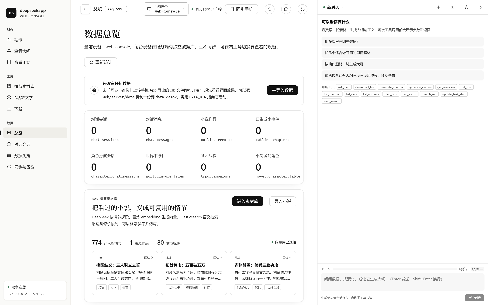<br/>
      <sub>Agent 面板 · 建议指令与 14 个可用工具</sub>
    </td>
  </tr>
</table>

### 情节素材库（RAG）

小说 txt 先做格式检测与章节结构化，再按「情节弧」切窗口（默认 12000 字、重叠 1500 字），
DeepSeek 并行提炼可复用情节，跨窗口去重后由百炼 embedding 写入 Elasticsearch，检索时走 kNN。

<table>
  <tr>
    <td align="center" valign="top" width="50%">
      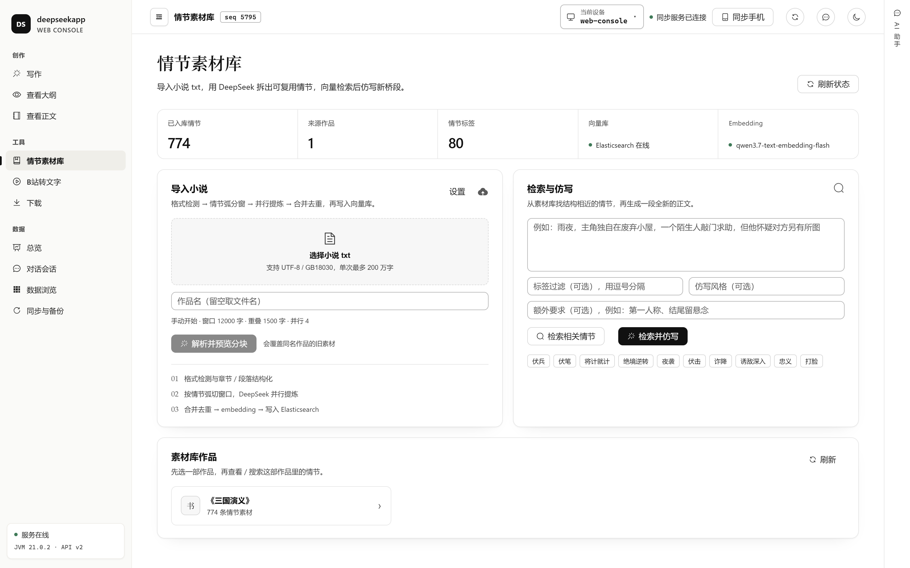<br/>
      <sub>素材库 · 已入库 774 条情节，导入与检索入口</sub>
    </td>
    <td align="center" valign="top" width="50%">
      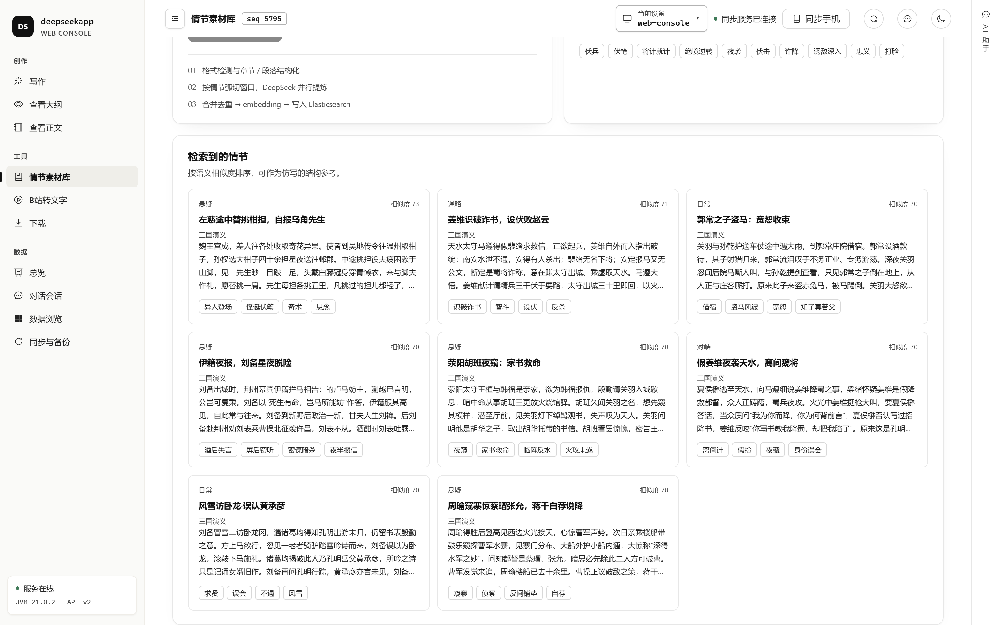<br/>
      <sub>语义检索 · 按相似度排序，带标签与摘要</sub>
    </td>
  </tr>
</table>

### 移动端

聊天、写小说、灵感推演与 AI 对战都在一个 App 里完成。

<table>
  <tr>
    <td align="center" valign="top" width="20%">
      <br/>
      <sub>对话 · 流式 / 思考 / 来源 / 缓存</sub>
    </td>
    <td align="center" valign="top" width="20%">
      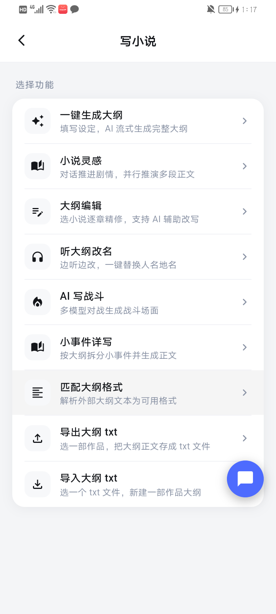<br/>
      <sub>写小说 · 9 个功能入口</sub>
    </td>
    <td align="center" valign="top" width="20%">
      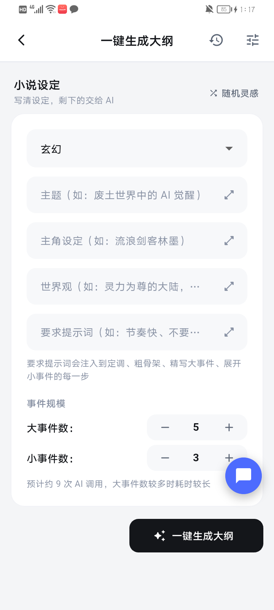<br/>
      <sub>一键生成大纲</sub>
    </td>
    <td align="center" valign="top" width="20%">
      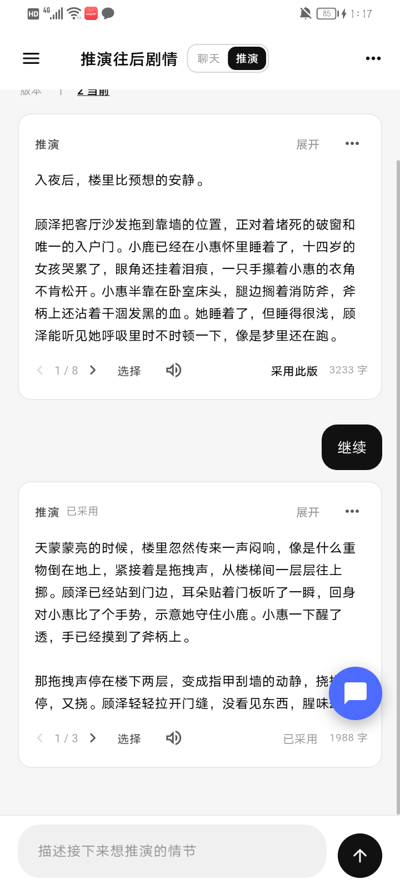<br/>
      <sub>小说灵感 · 并行推演</sub>
    </td>
    <td align="center" valign="top" width="20%">
      <br/>
      <sub>AI 写战斗</sub>
    </td>
  </tr>
</table>

### Web 控制台

<table>
  <tr>
    <td align="center" valign="top" width="50%">
      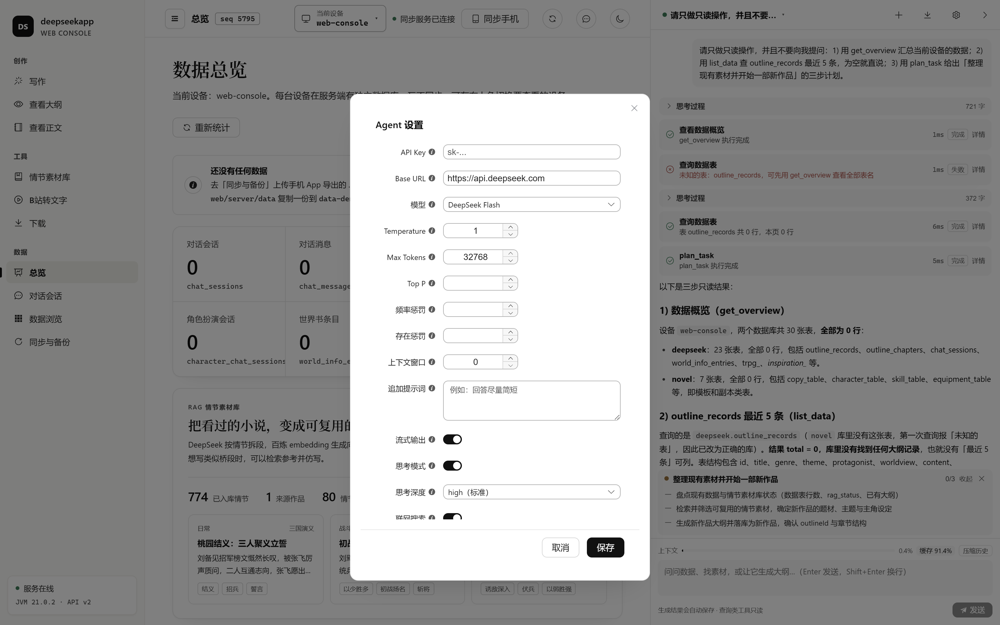<br/>
      <sub>Agent 设置 · 模型 / 思考深度 / 联网搜索 / 上下文窗口</sub>
    </td>
    <td align="center" valign="top" width="50%">
      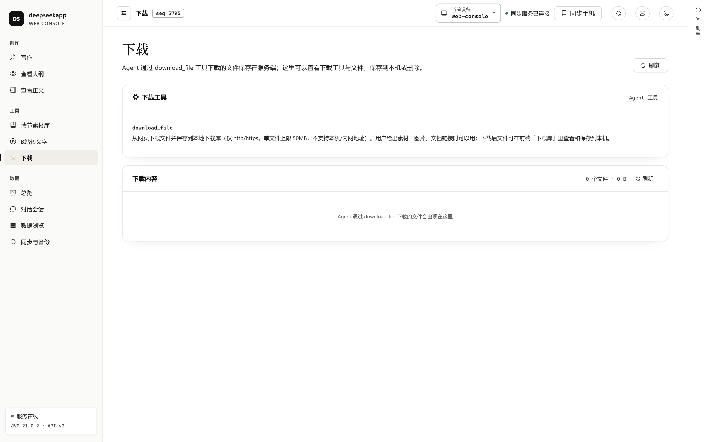<br/>
      <sub>下载库 · Agent 通过工具保存的文件</sub>
    </td>
  </tr>
</table>

---

## 核心亮点

工程实现集中在 Agent 运行时与 LLM 应用层，下面的数字都来自本地真实运行和真实 API 对照，不是估算。

- **Agent 运行时：事件驱动、可回放、可恢复**
  `session → message → run → event` 四层持久化，每轮 run 通过 SSE 推送带自增 `seq` 的事件
  （message / tool / task / ask / stage / download / usage / done）。前端断线后按 `seq` 回放，
  不重不漏；服务重启时扫描未完成的 run，用 journal + checkpoint 续跑；支持用户取消与会话单飞。
  run 跑在虚拟线程上，进程内信号量限制 8 个并发，单轮最多 8 次模型请求。

- **Function Calling：14 个工具的统一注册与编排**
  用 Spring AI 的 `@Tool` 注解生成 JSON Schema，集中到 `AgentToolCatalog`：数据只读查询 3 个、
  RAG 2 个、写作 4 个（生成的大纲/章节自动落库）、任务计划 2 个、向用户提问 1 个、联网搜索 1 个、
  下载 1 个。前端把每次调用渲染成可展开的工具卡，完整展示入参与返回，而不是只显示"正在调用"。

- **Human-in-the-loop：`ask_user` 阻塞式提问**
  需要用户拍板时，工具在虚拟线程里挂起等待，最长 5 分钟；前端弹出选项卡（支持自定义输入），
  提交后唤醒 run 继续执行。提问和回答都进入事件流，断线重连或进程重启后依然能恢复。

- **多步任务：`plan_task` + `update_task_step`**
  Agent 把复杂任务拆成有状态的步骤清单，每次工具调用回写步骤状态；前端任务卡实时显示
  完成进度（如 3/3）。任务落库，重启后按库里的状态继续，而不是让用户从头再说一遍。

- **1M 上下文：检查点式压缩**
  阈值取 `floor(min(W×0.8, W−输出预留−65536))`，保留最近 `(W−输出预留)×16%` 原文；
  只压缩"检查点之后、保留段之前"的消息，用一次非流式调用生成结构化检查点
  （用户目标 / 已确认事实 / 已完成 / 约束）写回 `agent_sessions.summary`。
  支持多次压缩合并旧检查点，压缩失败不阻断对话。

- **前缀缓存：把成本优化成可验证的数字**
  系统提示只放稳定内容、工具定义按名称排序、当前时间后置到最后一条用户消息，让大段固定内容
  始终位于前缀。接入 `stream_options.include_usage`，解析 `prompt_cache_hit_tokens`
  （兼容 `prompt_tokens_details.cached_tokens`）。同一会话第二轮命中
  **2816 / 3010 ≈ 93.6%**，两轮累计 5632 / 6010 ≈ 93.7%；面板同时展示会话累计、
  最近一次和单条消息的命中率。

- **自研 OpenAI 兼容流式客户端**
  没有用 Spring AI 托管的 ChatClient（只用它的 `@Tool` 生成 schema）：自己解析
  `delta / reasoning_content / tool_calls` 分片与 usage；首 token 前失败自动重试，
  首 token 后不重试，避免重复内容；工具调用按 index 累积后一次性执行；支持取消与超时。

- **联网搜索缓存 0 命中的排查**
  普通回答命中 64%~74%，联网搜索回答却恒为 0。定位到第二阶段"重建历史 + 删掉 tools +
  时间注记位置不一致"导致前缀失配，改为"复用第一阶段消息快照 + 保留 tools + 搜索结果尾部追加
  + 指令约束 + 兜底重试"，真实 API 命中从 **0 → 256/416**；过程中还发现
  `tool_choice: none` 会让服务端把 tools 从提示词里剥离（输入 354 → 86 tokens）。

- **RAG：从整本小说到可检索情节**
  自研 `RagDocumentParser`：格式检测 → 段落重建 → 章节识别 → 情节弧窗口（按章组窗、绝不跨章、
  句边界重叠）；窗口并行提炼（带续接状态）→ 跨窗口 bigram / Jaccard 去重 → 百炼 1024 维 embedding
  → Elasticsearch `dense_vector` kNN。当前素材库 774 条、80 个标签，Agent 通过 `search_rag`
  只读调用把结果作为后续写作的参考桥段；完整流程见下方「情节素材库（RAG）」。

---

## 功能模块

| 模块 | 能力 |
| --- | --- |
| 对话 | DeepSeek 流式问答、Markdown 渲染、思考过程折叠、联网搜索来源、上下文占用与缓存命中展示、会话历史 |
| 小说写作 | 大纲生成（分阶段）、大纲编辑与格式校验、章节写作/改写、灵感推演（并行候选 + 合并）、AI 对战、听书 TTS |
| 情节素材库（RAG） | txt 导入与预览、格式/章节识别、情节弧窗口切分、并行提炼、跨窗口去重、embedding + kNN 检索与仿写 |
| 游戏 | 角色对话、文字 TRPG、小说互动游戏 |
| 数据同步 | 多设备隔离、增量同步、冲突留档、`.db` 导入导出、USB / 局域网自动发现 |
| Web 控制台 | 总览、会话、31 张表通用数据浏览器、同步与备份、情节素材库、B站视频转文字、下载库、Agent 面板 |
| Agent | 14 个工具、任务计划、向用户提问、SSE 实时渲染、断线重连与恢复、会话级设置与用量统计 |
| 应用更新 | 更新公告、APK 下载与版本隔离 |

---

## 情节素材库（RAG）

这里不是"切块后直接丢向量库"：先把小说解析成结构化文本，再按情节弧切窗口、并行提炼、
跨窗口去重，最后才 embedding 入库。

### 1. 导入与预览

- 支持 UTF-8 / GB18030 编码的 txt，单次最多 200 万字；
- `analyze` 阶段只做解析与分块，不调用模型：先告诉用户识别到几章、几个窗口，
  调整窗口/重叠字数后可 `resplit` 重新预览，确认后 `start` 才真正提炼；
- 任务、每个窗口的原文与模型原始输出都保存在服务端，切走页面后可通过 `/api/rag/jobs` 恢复进度。

### 2. 文本清洗与段落重建

- 统一换行，去掉 BOM、NUL，剥离混入的 HTML 标签，合并连续空格与多余空行；
- 自动判断三种排版：空行分段、单换行分段（一行一段的网文）、整篇无换行；
- 整篇无换行时先按句末标点切句再组段；超过 1800 字的长段落也先按句子切开，
  保证窗口落在句子边界而不是半句话中间。

### 3. 章节识别

- 三类标题模式从强到弱：`第X回/章/节`、`Chapter N`、`数字标题`；
- 至少命中 3 处才认为识别到章节；数字标题还要求编号单调递增，避免把列表项误判成章节；
- 章节标题前若有 ≥100 字内容，单独作为「前言」；
- 识别到章节就按「章」组窗口，**绝不跨章切**；没有章节时按段落组窗口。

### 4. 情节弧窗口（文本切分核心）

- 目标窗口默认 12000 字，可调 4000~30000；相邻窗口重叠默认 1500 字，上限 `min(5000, 窗口/2)`；
- 重叠前缀尽量从句子开头截取，保证跨窗口的完整情节至少在一个窗口里完整出现；
- 单个窗口最多 12 章；单章超过 2 倍窗口时，在章内部按句末标点再切，标题标成「（续 N）」；
- 最多 400 个窗口，超过直接拒绝导入，避免一次任务把模型调用打爆。

### 5. 并行提炼（DeepSeek）

- 各窗口并行提炼，并发默认 4（可调 1~8）；每个窗口的 prompt 带上全书窗口数、当前章节范围，
  以及上一批最后一个情节的摘要作为「续接状态」；
- 输出严格 JSON：title / plot（200~450 字）/ excerpt（原文 120~300 字）/ tags（3~6 个）/
  characters / sceneType / emotion / reusable（可复用的戏剧结构）；
- 规则要求"宁少勿滥，每段 1~5 条"、"不虚构原文没有的事实"、"开头/结尾不完整的情节不要硬造结局"；
- 提炼温度 0.25，单窗口失败最多重试 3 次（退避 0.8s / 1.6s），仍失败则整个任务报错并标出窗口序号。

### 6. 跨窗口合并去重

- 对标题和 plot 做字符 bigram + Jaccard 相似度；
- 标题相似度 ≥ 0.80 且 plot ≥ 0.45，或 plot ≥ 0.82，判定为重复并合并；
- 合并后上限 3000 条，超限直接报错，避免一次导入写出过大的索引。

### 7. Embedding 与 Elasticsearch 入库

- embedding 文本不是只取 plot，而是「标题 + 情节 + 标签 + 人物 + 场景 + 情绪 + 可复用结构」拼接，
  检索时结构信息也参与相似度计算；
- 阿里百炼 `qwen3.7-text-embedding-flash`，1024 维，批量 8 条一次请求；
- 按作品先删后写：`_delete_by_query` 清掉同书旧数据，再用 `_bulk?refresh=true` 批量写入；
- 索引 mapping：title / plot / excerpt / reusable 用 `ik_max_word`（无 ik 插件时自动回退 standard），
  tags / characters / sceneType / emotion / book 用 keyword，
  embedding 是 `dense_vector(dims=1024, similarity=cosine)`，单分片、0 副本。

### 8. 检索与仿写

- 查询文本先 embedding，再走 ES kNN：`k ≤ 30`、`num_candidates = max(50, k×10)`，
  标签用 `terms` 过滤，返回按相似度排序的情节；
- 仿写时把参考情节的「结构 / 冲突节奏 / 情绪曲线」交给 DeepSeek（temperature 0.9，8192 输出），
  硬性要求不照抄句子、不复用参考中的人名与具体事件；
- Agent 里的 `search_rag` / `rag_status` 就是这两个能力的只读封装：先检索，再基于参考桥段继续写。

### 9. 设置与持久化

- 窗口字数、重叠字数、并发数、「分块后是否手动开始提炼」保存在 `data/rag/settings.json`（原子落盘）；
- 当前素材库：774 条情节、1 部作品、80 个标签；Elasticsearch 在线时状态页会实时显示索引信息。

---

## 系统架构

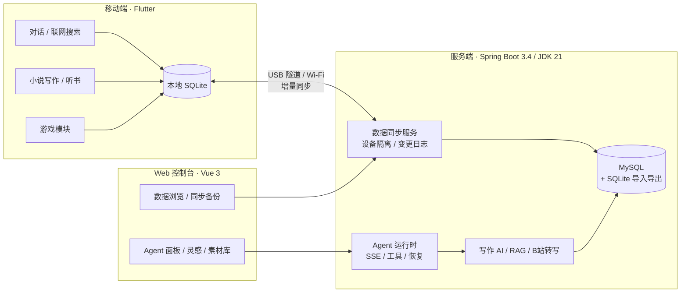

---

## 技术栈

| 端 | 技术 |
| --- | --- |
| 移动端 | Flutter（Dart 3.12）、Riverpod、Dio、sqflite、flutter_markdown_plus、sherpa-onnx（本地 TTS） |
| 服务端 | Java 21、Spring Boot 3.4.5、Spring AI 1.0.9、MyBatis-Plus 3.5.9、MySQL 8、sqlite-jdbc、SSE、虚拟线程 |
| Web 控制台 | Vue 3.5、TypeScript 5.9、Pinia、Vue Router、Element Plus、Vite 7 |
| 数据与检索 | MySQL / SQLite、Elasticsearch、阿里百炼 Embedding、DeepSeek API |

---

## 快速开始

### 环境要求

- Flutter（Dart SDK ≥ 3.12.2）
- JDK 21、MySQL 8（服务端主存储）
- Node.js 18+ 与 npm
- 可选：`adb`（USB 隧道同步）、Python + faster-whisper（B站视频本地转写）

### 1. 移动端

```bash
flutter pub get
flutter run
```

打包调试包真机验证：

```powershell
flutter build apk --debug
adb install -r build\app\outputs\flutter-apk\app-debug.apk
```

首次使用请在 App「设置」里填入 DeepSeek API Key。同步功能是可选的，不连服务端也能单独使用。

### 2. 服务端

```powershell
cd web/server-java
.\mvnw.cmd spring-boot:run
```

macOS / Linux：

```bash
cd web/server-java
./mvnw spring-boot:run
```

默认监听 `http://localhost:3210`。常用环境变量（建议写在 `web/server/.env`，该文件已被忽略）：

| 变量 | 说明 |
| --- | --- |
| `DEEPSEEK_API_KEY` | DeepSeek 密钥，Agent / 写作 / RAG 均使用 |
| `DASHSCOPE_API_KEY` | 阿里百炼 Embedding 密钥（RAG 可选） |
| `MYSQL_HOST` / `MYSQL_PORT` / `MYSQL_DATABASE` / `MYSQL_USER` / `MYSQL_PASSWORD` | 数据库连接 |
| `API_TOKEN` | 接口令牌；**公网部署必须设置**，否则任何人都能读写数据 |
| `DATA_DIR` | 数据目录，默认 `web/server/data` |
| `PORT` | 服务端口，默认 `3210` |

### 3. Web 控制台

```bash
cd web/app
npm install
npm run dev      # http://localhost:5173，/api 自动代理到 3210
npm run build    # 产物由服务端同源托管
```

生产模式下先 `npm run build`，再启动服务端，直接访问 `http://localhost:3210` 即可。

---

## 目录结构

```
.
├─ lib/                       Flutter App 源码
│  ├─ core/                   网络 / 数据库 / 配置 / 通用组件
│  └─ features/
│     ├─ chat/                对话与联网搜索
│     ├─ novel_writing/       大纲 / 章节 / 灵感 / 对战 / 听书
│     ├─ game/                角色对话 / TRPG / 小说游戏
│     ├─ sync/                多设备数据同步
│     └─ update/              应用更新
├─ android/                   Android 工程（TTS 模型与 so 位于 app/src/main/assets、libs）
├─ web/
│  ├─ app/                    Vue 3 控制台
│  ├─ server-java/            Spring Boot 服务（同步 / Agent / 写作 / RAG / B站转写）
│  ├─ docs/                   使用指南 / 同步协议 / 数据模型 / RAG 说明
│  └─ server/data/            运行时数据目录（数据库、密钥，已被 git 忽略）
├─ test/                      单元测试与 UI 测试
└─ docs/screenshots/          README 截图
```

---

## 文档

- [Web 数据台说明](web/README.md)
- [使用指南](web/docs/使用指南.md)
- [同步协议](web/docs/同步协议.md)
- [数据模型](web/docs/数据模型.md)
- [RAG 素材库](web/docs/rag.md)
- [开发文档](开发文档.md)

---

## 安全与隐私

- 仓库**不包含**任何数据库、运行日志、会话截图或个人数据；`*.db`、`web/server/`、`reports/`
  等运行时目录均已加入 `.gitignore`。
- API Key 只通过环境变量或 `web/server/.env` 注入，配置文件里全部是占位符。
- `application.yml` 中的数据库密码、DeepSeek Key、百炼 Key 均从环境变量读取，不在仓库中保存明文。
- 公网部署务必设置 `API_TOKEN`；默认配置面向本机 / 局域网使用。
- 导出数据库时会清空 `apiKey` / `baidu_api_key` 等敏感字段，方便备份与分享。
- Agent 的下载工具只允许 http/https，拒绝本机与内网地址，并限制文件大小，防止 SSRF。

---

## 已知限制

- 单机部署，进程内并发上限 8；run / ask 注册表在内存中，重启恢复是单机语义。
- 暂无多租户与 RBAC，身份依赖客户端自报的 `x-device-id` + 可选全局令牌。
- 写类工具（生成大纲 / 章节）暂未接入人工审批。
- RAG 索引是服务端全局的（按作品名区分），不按设备或用户隔离；未配置 `DASHSCOPE_API_KEY` 时只能浏览已有素材，不能检索或导入。
- 暂无 CI/CD 与 Agent 评测集。

---

<div align="center">
<sub>如果这个项目对你有帮助，欢迎 Star ⭐</sub>
</div>
